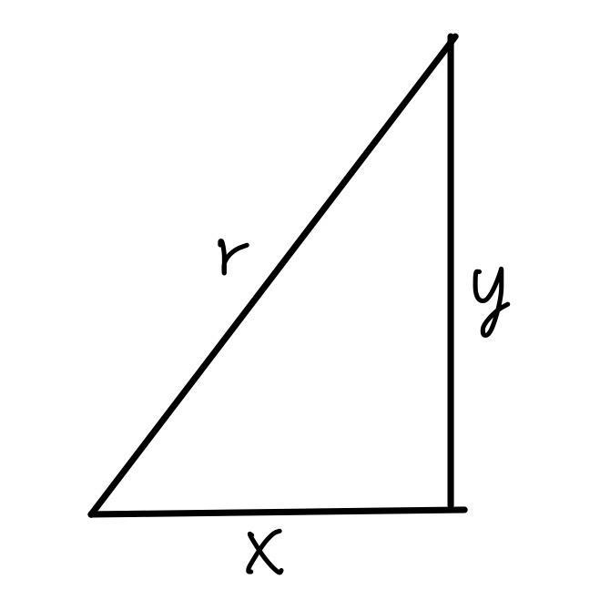
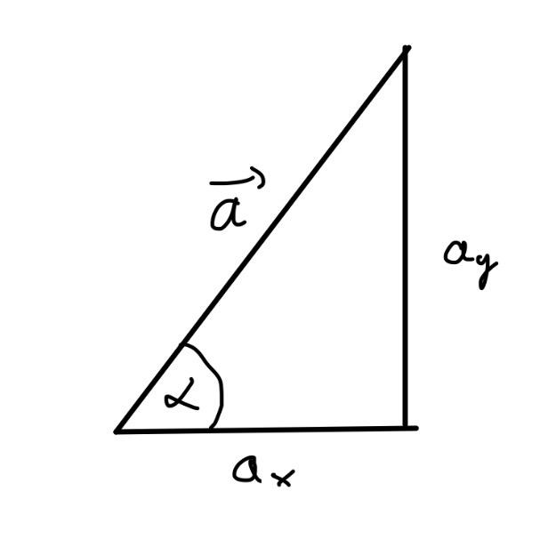

# Orbit-Simulator
Ein 2D-Simulator in Python, der die Bahn eines Satelliten um die Erde berechnet.


## Was macht das Programm?

Der Satellit startet mit der Geschwindigkeit für eine Kreisbahn
(bei 400 km Höhe ca. 7672 m/s). In jedem Zeitschritt wird die Schwerkraft
berechnet, daraus werden Geschwindigkeit und Ort aktualisiert.
Bei 400 km Höhe dauert ein Umlauf etwa 92,4 Minuten.

## Versionen

Die erste Version hatte eine feste Höhe von 400 km. In der aktuellen Version
gibt man die Höhe ein, und die Umlaufzeit wird automatisch berechnet.
Die alte Version steht im Verlauf (Commits).

## Wie komme ich auf die Formeln?

Die Schwerkraft zeigt immer zur Erde. Weil der Computer nur in x- und y-Richtung
rechnet, zerlege ich sie mit einem rechtwinkligen Dreieck in zwei Teile.

Satz des Pythagoras für den Abstand zur Erde:



```math
r = \sqrt{x^2 + y^2}
```

Zerlegung der Schwerkraft mit cos und sin:



```math
a_x = -\frac{G \cdot M \cdot x}{r^3} \qquad a_y = -\frac{G \cdot M \cdot y}{r^3}
```

Kreisbahngeschwindigkeit (Gravitationskraft = Zentripetalkraft):

```math
v = \sqrt{\frac{G \cdot M}{r}}
```

Umlaufzeit:

```math
T = \frac{2 \pi r}{v}
```


## Ergebnisse

Gemessen mit der aktuellen Version (400 km Höhe): Ich habe zwei Reihenfolgen
verglichen und geschaut, wie weit der Abstand zur Erde nach einem vollen Umlauf
(ca. 5545 s) vom Startwert abweicht. Wenn zuerst der Ort und
dann die Geschwindigkeit aktualisiert wird, weicht die Bahn bei einem Zeitschritt
von 1 s um etwa 98 km ab, bei 0,1 s um etwa 9,9 km. Wird zuerst die Geschwindigkeit
und dann der Ort aktualisiert, sind es bei 0,1 s nur etwa 190 m.

Ein kleinerer Zeitschritt macht die Rechnung genauer. Außerdem ist es besser,
zuerst die Geschwindigkeit und dann den Ort mit der neuen Geschwindigkeit
zu aktualisieren.


