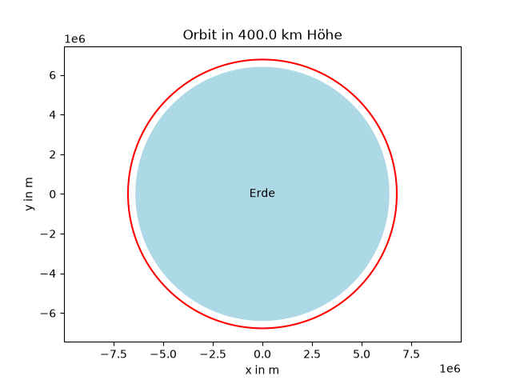

# Orbit-Simulator
Ein 2D-Simulator in Python, der die Bahn eines Satelliten um die Erde berechnet.



## Was macht das Programm?

Der Satellit startet mit der Geschwindigkeit für eine Kreisbahn
(bei 400 km Höhe ca. 7672 m/s). In jedem Zeitschritt wird die Schwerkraft
berechnet, daraus werden Geschwindigkeit und Ort aktualisiert.
Bei 400 km Höhe dauert ein Umlauf etwa 92,4 Minuten.

## Versionen

Die erste Version hatte eine feste Höhe von 400 km. In der aktuellen Version
gibt man die Höhe ein, und die Umlaufzeit wird automatisch berechnet.
Die alte Version steht im Verlauf (Commits).

## Wie komme ich auf die Formeln?

### 1. Geschwindigkeit auf der Kreisbahn

Damit der Satellit auf einer Kreisbahn bleibt, muss die Gravitationskraft
genau die Zentripetalkraft sein:

```math
F_G = F_Z
```

```math
\frac{G \cdot M \cdot m}{r^2} = \frac{m \cdot v^2}{r}
```

Die Masse m des Satelliten kürzt sich weg, und nach v aufgelöst ergibt das:

```math
v = \sqrt{\frac{G \cdot M}{r}}
```

### 2. Beschleunigung durch die Schwerkraft

Aus F = m · a folgt:

```math
m \cdot a = \frac{G \cdot M \cdot m}{r^2} \quad \Rightarrow \quad a = \frac{G \cdot M}{r^2}
```

Die Beschleunigung zeigt zum Erdmittelpunkt, deshalb bekommt sie ein Minus.

### 3. Abstand zur Erde

Die Schwerkraft zeigt immer zur Erde. Weil der Computer nur in x- und y-Richtung
rechnet, brauche ich den Abstand r aus x und y. Das ist der Satz des Pythagoras:

.jpeg)

```math
r^2 = x^2 + y^2 \quad \Rightarrow \quad r = \sqrt{x^2 + y^2}
```

### 4. Zerlegung in x und y

Mit demselben Dreieck zerlege ich die Beschleunigung in zwei Teile:

.jpeg)

```math
\cos(\alpha) = \frac{x}{r} \qquad \sin(\alpha) = \frac{y}{r}
```

Der x-Teil ist die Beschleunigung mal cos(α), der y-Teil mal sin(α):

```math
a_x = -\frac{G \cdot M}{r^2} \cdot \frac{x}{r} = -\frac{G \cdot M \cdot x}{r^3}
```

```math
a_y = -\frac{G \cdot M}{r^2} \cdot \frac{y}{r} = -\frac{G \cdot M \cdot y}{r^3}
```

### 5. Umlaufzeit

Für einen Umlauf legt der Satellit den Umfang des Kreises zurück,
mit der Geschwindigkeit v:

```math
T = \frac{\text{Strecke}}{\text{Geschwindigkeit}} = \frac{2 \pi r}{v}
```

Daraus berechnet das Programm, wie viele Zeitschritte für einen Umlauf nötig sind.

## Ergebnisse

Gemessen mit der aktuellen Version (400 km Höhe): Ich habe zwei Reihenfolgen
verglichen und geschaut, wie weit der Abstand zur Erde nach einem vollen Umlauf
(ca. 5545 s) vom Startwert abweicht. Wenn zuerst der Ort und
dann die Geschwindigkeit aktualisiert wird, weicht die Bahn bei einem Zeitschritt
von 1 s um etwa 98 km ab, bei 0,1 s um etwa 9,9 km. Wird zuerst die Geschwindigkeit
und dann der Ort aktualisiert, sind es bei 0,1 s nur etwa 190 m.

Ein kleinerer Zeitschritt macht die Rechnung genauer. Außerdem ist es besser,
zuerst die Geschwindigkeit und dann den Ort mit der neuen Geschwindigkeit
zu aktualisieren.
